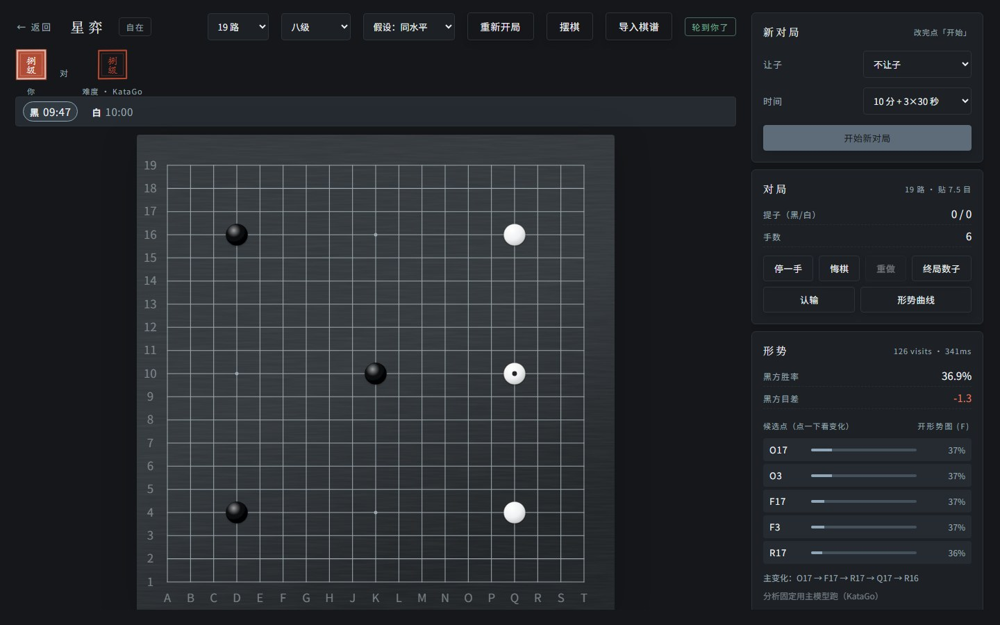
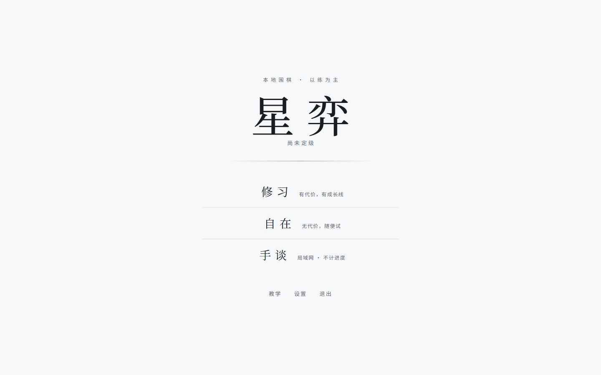
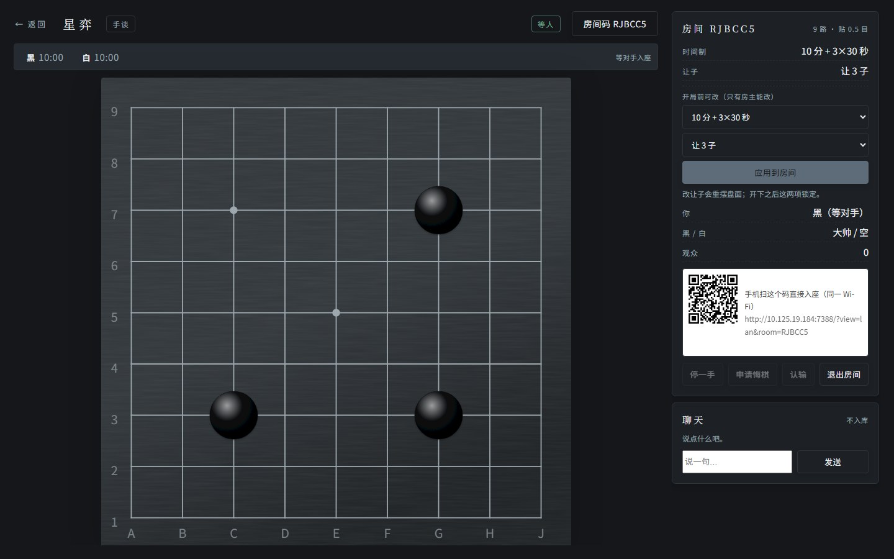
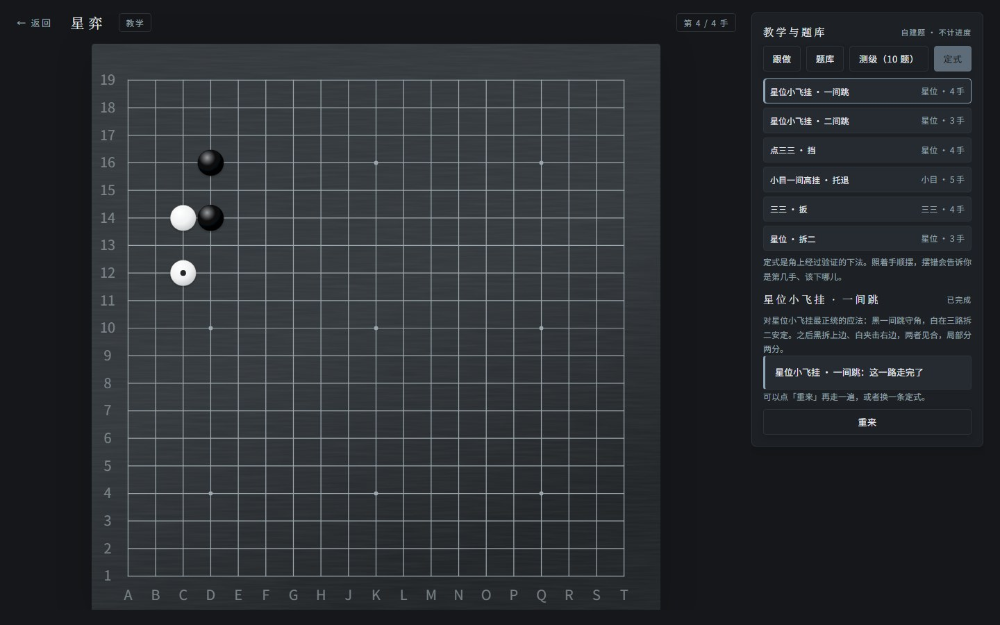
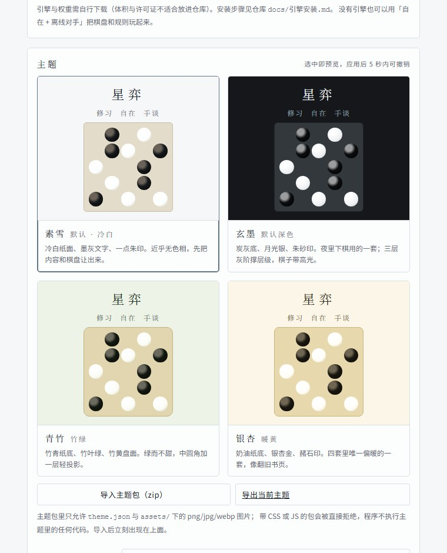

# 星弈 · xingyi

> 跑在自己电脑上的围棋软件。KataGo 当对手和老师，三种模式三套规则，界面可换主题。




## 这是什么

一个**本地优先**的围棋练习软件：装在自己的电脑上，开浏览器就能用。不用注册、不联网对弈，棋谱与进度都留在本机。

练棋是主线——**修习**把「你现在几级」变成一条能看见的成长线；**自在**留给随手试；**手谈**给同一个 Wi-Fi 下的两个人（手机、平板都行）；**教学**里有一套自建题库和定式跟做。棋盘、规则、数子、复盘全部自己实现，不依赖任何第三方棋盘库。

## 功能

| 模块 | 能做什么 |
|---|---|
| **自在** | 9/13/19 路对局（KataGo 或自带离线对手）；让 2~9 子；可选的棋钟（包干 / 读秒）；悔棋、重做、停一手、认输、终局数子；点一颗死子整块标死；复盘（分块进度 + 可中断 + 黑白分色）；摆棋分析；SGF 导入导出、拖拽导入；候选点、胜率/目差、形势图（F 键） |
| **修习** | 3 盘定级 → 15 级成长线；升降级按本级步长判定；跳档考核（升 1/2 级）；保级期与退级缓冲；防刷；评级沙盘；进度存档（含每日备份）与导出 |
| **手谈** | 局域网房间码 / 二维码入座；自动发现同网段房间；观战；聊天；悔棋需对方同意；房间棋钟（主时间 + 读秒，4 档时间制，超时判负）；让 2~9 子；房主开局前可改设置；断线重连自动回座 |
| **教学** | 100 道自建提子题（每题都由规则引擎验算）、10 题测级、6 个定式跟做（走错会告诉你第几手该下哪儿） |
| **主题** | 素雪 / 玄墨 / 青竹 / 银杏四套内置，即时切换、5 秒内可撤销；主题包 zip 导入导出（只收 json + 图片，禁 CSS/JS） |
| **引擎** | KataGo GTP 串行客户端；后端探测与五步自检；进程守护；1~15 级的参数映射（human SL 档位经过实测校准） |

**没装引擎也能玩**：自在模式会自动退化为程序自带的离线对手，规则与棋盘都是真的，一样能下完并数目判胜负。修习模式必须先有引擎——等级是拿引擎校准出来的，凭空凑只会误导人。

## 截图

| | |
|---|---|
|  |  |
| 主界面：修习 / 自在 / 手谈三套规则世界 | 手谈：房间码、二维码入座、两台棋钟、让子 |
|  |  |
| 定式跟做：逐手校验，走错给提示 | 主题：素雪 / 玄墨 / 青竹 / 银杏 |

## 快速开始

```bash
git clone https://github.com/bailacking/xingyi.git
cd xingyi
npm install
npm run dev        # 服务 7388 + 前端 5173
```

打开 **http://localhost:5173** 。生产模式：

```bash
npm run build && npm start   # 只跑 7388，前端由服务托管
```

Windows 用户可直接双击 **`start.bat`**（开发模式）或 `start.bat prod`（生产模式）：自动查 Node、缺依赖就装、缺构建就构建、延迟几秒开浏览器，关窗口即停。

## 引擎要自己装

仓库**不内置** KataGo 与权重（体积和许可证都不适合入库）。设置页有三步向导，每一栏当场校验并给中文原因：

1. 选后端（探测显卡，推荐 CUDA / OpenCL / Eigen）
2. 指定 `katago` 程序
3. 指定主模型与 human SL 模型

完整步骤、DLL 依赖与本机实测数据见 **[docs/引擎安装.md](docs/引擎安装.md)**。

> 参考实测（RTX 3050 Ti Laptop 4 GB）：双模型可同进程加载，显存 985 MB，约 540 visits/s。

## 项目结构

```
packages/   共享类型 · 规则引擎 · 评级 · 引擎客户端（前后端共用）
server/     Fastify REST + WS：对局、房间、SGF、结算、进度、主题包
web/        React 前端：SVG 棋盘、对局/复盘/摆棋、教学、手谈、设置、四套主题
data/       ranks.json（入库）；引擎/模型/配置/棋谱/导入的主题（不入库）
docs/       引擎安装 · 评级说明 · 主题规范 · 测试清单 · 已知问题 · 截图
```

## 常用命令

| 命令 | 作用 |
|---|---|
| `npm run dev` | 服务 + 前端一起跑 |
| `npm test` | 全部单测（168 项） |
| `npm run typecheck` | 全量类型检查 |
| `npm run build` | 构建 packages + server + web |
| `npm start` | 只跑生产服务（7388） |
| `node scripts/gen-tsumego.mjs` | 重新生成题库（逐题用规则引擎验算） |

## 文档

- [docs/引擎安装.md](docs/引擎安装.md) —— KataGo / 权重 / 后端选择与实测数据
- [docs/评级说明.md](docs/评级说明.md) —— 级数模型、升降级阈值、定级赛规则
- [docs/主题规范.md](docs/主题规范.md) —— token 契约、主题包格式与校验规则
- [docs/测试清单.md](docs/测试清单.md) —— 手动回归清单
- [docs/已知问题.md](docs/已知问题.md) —— BUG 登记与修复记录
- [AGENTS.md](AGENTS.md) —— 给改代码的人：架构、不变量、API、踩过的坑

## 许可与致谢

[MIT](LICENSE) · 第三方依赖与素材登记在 [THIRD-PARTY.md](THIRD-PARTY.md)。

感谢 [KataGo](https://github.com/lightvector/KataGo)（MIT）、[思源宋体 / 思源黑体](https://github.com/adobe-fonts)（SIL OFL）。
